# RespondHelper

<p align="center">
  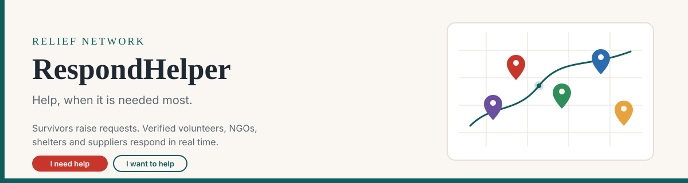
</p>

<p align="center">
  
  
  
  
</p>

Real-time disaster management and emergency response. Survivors request help. Verified volunteers, NGOs, shelters, and resource providers respond. Admins run the network from a command center.

The product UI is branded **Relief Network**. Matching uses location, urgency, availability, and verification so the closest capable responder gets the request.

**Repository:** [krish2006-jain/RespondHelper](https://github.com/krish2006-jain/RespondHelper)

---

## How it works

<p align="center">
  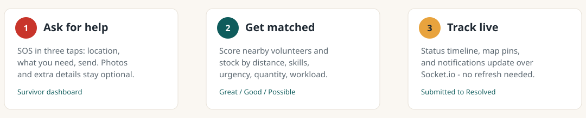
</p>

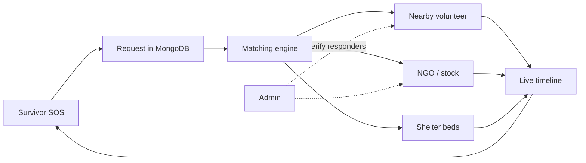

---

## What it does

- **SOS in three taps** — auto-detect location, choose a need, send. Extra details stay optional.
- **Emergency requests** — food, water, medicine, shelter, rescue, transport, clothing, and more, with priority and a full status lifecycle.
- **Live map** — Leaflet + OpenStreetMap with distinct markers for critical requests, volunteers, NGOs, shelters, and resources.
- **Matching** — scores volunteers (distance, skills, availability, workload) and resources (urgency, distance, quantity, stock).
- **Role dashboards** — survivor, volunteer, NGO / resource provider, shelter, and admin command center.
- **Trust** — responders stay pending until an admin verifies them. Unverified accounts cannot take tasks or appear as available on the map.
- **Real-time** — Socket.io for request tracking, occupancy, inventory alerts, and in-app notifications.

---

## Architecture

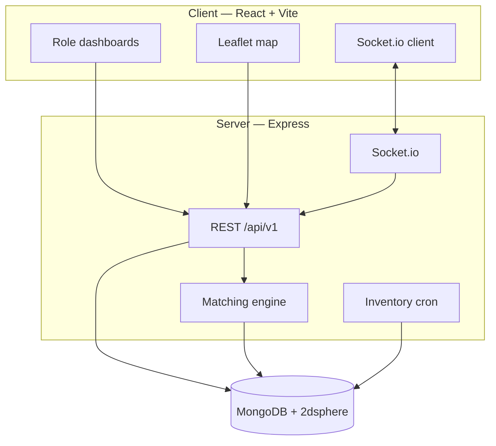

| Layer | Tech |
|---|---|
| Client | React 18, Vite, Tailwind CSS, React Router, Leaflet, Recharts, Axios, Socket.io client |
| API | Node.js, Express, MongoDB / Mongoose (`2dsphere`), Socket.io, JWT, bcrypt, Multer, Helmet, rate limiting |
| Maps | OpenStreetMap tiles (no API key required) |

---

## Roles

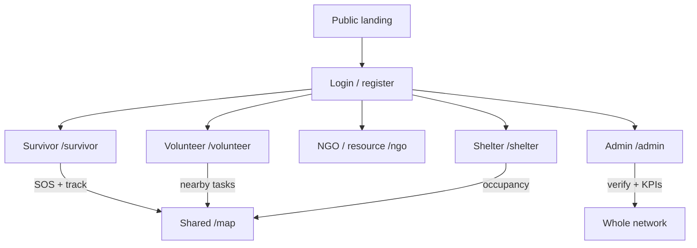

| Role | After login | Responsibility |
|---|---|---|
| Survivor | `/survivor` | Raise SOS / requests, track help, find shelters and the map |
| Volunteer | `/volunteer` | Toggle availability, accept nearby tasks, update progress |
| NGO | `/ngo` | Inventory, ranked assignments, request handling |
| Shelter | `/shelter` | Capacity, occupancy, facilities, nearby demand |
| Resource provider | `/ngo` | Same resource tools as NGOs |
| Admin | `/admin` | Verification queue, users, KPIs, analytics, reassignment |

Survivors can act immediately after sign-up. Other responder roles need admin approval.

---

## Request lifecycle

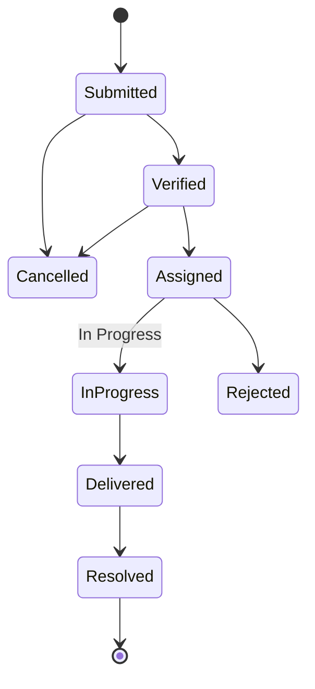

Every change is stored in `statusHistory`.

Volunteer task steps:

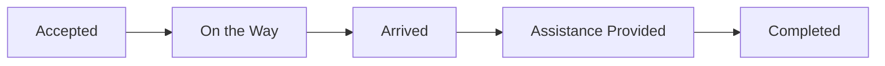

---

## Emergency map

<p align="center">
  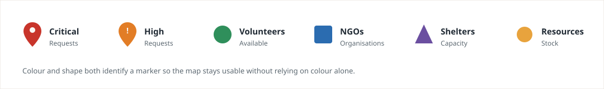
</p>

---

## Matching

Weights live in environment variables. Example: a **critical medicine** request for **20 units**.

<p align="center">
  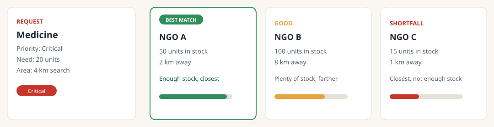
</p>

**Resources:** urgency + distance + quantity + availability. Insufficient stock is penalized. Results include a short reason such as “Has 50 units, 2 km away.”

**Volunteers:** distance + skill fit + request priority + availability + current workload, limited to the volunteer’s service radius and `VOLUNTEER_MAX_ACTIVE_TASKS`. Labels: Great / Good / Possible.

---

## Colour system

Red is reserved for real urgency.

<p align="center">
  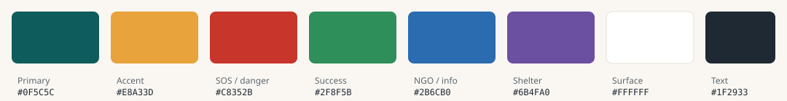
</p>

Full UI rules: [`design.md`](design.md).

---

## Prerequisites

- Node.js 18+
- MongoDB (local or Atlas)
- npm

---

## Quick start

```bash
git clone https://github.com/krish2006-jain/RespondHelper.git
cd RespondHelper
npm run install:all
```

### Environment

Copy `env.example` into two files:

1. **`server/.env`** (or a root `.env` — the API loads both)
2. **`client/.env`** — only `VITE_*` variables

Minimum server values:

```env
NODE_ENV=development
PORT=5000
API_PREFIX=/api/v1
CLIENT_URL=http://localhost:5173
CORS_ORIGINS=http://localhost:5173
MONGO_URI=mongodb://127.0.0.1:27017/disaster_platform
MONGO_DB_NAME=disaster_platform
JWT_ACCESS_SECRET=replace_with_long_random_string
JWT_REFRESH_SECRET=replace_with_another_long_random_string
```

Minimum client values:

```env
VITE_API_BASE_URL=http://localhost:5000/api/v1
VITE_SOCKET_URL=http://localhost:5000
VITE_APP_NAME=Relief Network
VITE_EMERGENCY_HELPLINE=112
VITE_DEFAULT_MAP_LAT=19.0760
VITE_DEFAULT_MAP_LNG=72.8777
VITE_DEFAULT_MAP_ZOOM=11
VITE_MAP_TILE_URL=https://{s}.tile.openstreetmap.org/{z}/{x}/{y}.png
```

Generate JWT secrets:

```bash
node -e "console.log(require('crypto').randomBytes(64).toString('hex'))"
```

SMTP, Cloudinary, Twilio, and Mapbox are optional. Uploads default to local disk (`server/uploads`).

### Run

```bash
# both API (port 5000) and Vite (port 5173)
npm run dev
```

Or separately:

```bash
npm run server:dev
npm run client:dev
```

Health check: [http://localhost:5000/health](http://localhost:5000/health)  
App: [http://localhost:5173](http://localhost:5173)

### Seed demo accounts

MongoDB must be running. This **wipes** the database, then creates six verified Mumbai-area accounts.

```bash
npm run seed
```

| Role | Email | Password |
|---|---|---|
| Admin | `admin@relief.org` | `Admin@12345` |
| Survivor | `survivor@relief.org` | `Password@123` |
| Volunteer | `volunteer@relief.org` | `Password@123` |
| NGO | `ngo@relief.org` | `Password@123` |
| Shelter | `shelter@relief.org` | `Password@123` |
| Resource provider | `provider@relief.org` | `Password@123` |

---

## Project layout

```
RespondHelper/
├── client/                 # React + Vite UI
│   └── src/
│       ├── api/            # Axios helpers
│       ├── components/     # UI, map, SOS, layout
│       ├── context/        # Auth, socket, notifications, SOS drafts
│       ├── pages/          # One folder per role
│       └── routes/         # ProtectedRoute, RoleRoute
├── server/
│   └── src/
│       ├── config/         # DB, env, Socket.io
│       ├── controllers/
│       ├── middleware/     # JWT, roles, uploads, rate limits
│       ├── models/
│       ├── routes/         # REST under /api/v1
│       ├── services/       # matching, notifications, inventory cron
│       ├── seed/
│       └── server.js
├── docs/assets/            # README diagrams
├── env.example
├── req.md                  # Product requirements
├── design.md               # UI / UX system
└── implementation.md       # Architecture notes
```

---

## API (prefix `/api/v1`)

Responses use `{ success, message, data }`. Errors use `{ success: false, message, errors? }`.

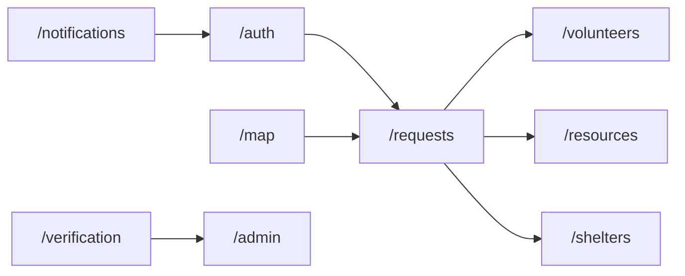

| Area | Examples |
|---|---|
| Auth | `POST /auth/register`, `/auth/login`, `/auth/refresh`, `/auth/logout`, `GET /auth/me` |
| Requests | `POST /requests`, `GET /requests/:id`, `PATCH /requests/:id/status`, `GET /requests/:id/matches` |
| Volunteers | `GET /volunteers/nearby-requests`, `POST /volunteers/tasks/:id/accept` |
| Resources | CRUD `/resources`, `GET /resources/alerts`, `POST /resources/:id/assign` |
| Shelters | CRUD `/shelters`, `PATCH /shelters/:id/occupancy`, `GET /shelters/nearby` |
| Map | `GET /map/entities?lat&lng&radius&types=` |
| Verification | `POST /verification/submit`, admin review routes |
| Notifications | `GET /notifications`, mark read |
| Admin | `GET /admin/stats`, users, block, analytics |

The backend enforces roles. A survivor calling an admin route receives `403`.

---

## Scripts

| Command | What it runs |
|---|---|
| `npm run install:all` | Root, `server`, and `client` dependencies |
| `npm run dev` | API + client together |
| `npm run seed` | Reset DB and insert demo users |
| `npm run build` | Production client build |

---

## Docs

- [`req.md`](req.md) — features, pages, schema, acceptance checks
- [`design.md`](design.md) — colour, type, SOS UX, accessibility
- [`implementation.md`](implementation.md) — folders, models, sockets, matching math
- [`env.example`](env.example) — full environment reference

---

## Security notes

- Never commit real `.env` files.
- Put secrets only on the server. The browser may only receive `VITE_*` values.
- Rate limits exist for auth and SOS routes. Accounts lock after repeated failed logins.

This is a coordination tool, not a replacement for emergency services. The UI shows the national helpline from `VITE_EMERGENCY_HELPLINE` (default **112** in India).
